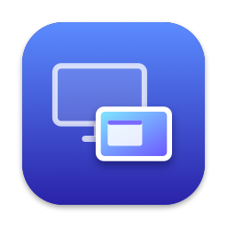

<h1 align="center">Screen Pad</h1>

Un vieil iPad comme écran d’appoint pour le Mac, en USB. <a href="README.md">English</a>

Screen Pad donne une seconde vie aux tout premiers iPad, dès l’iPad 2, comme écran du Mac :

- **Sur le Mac**, une app de la barre des menus crée un écran virtuel et l’envoie à l’iPad en vidéo H.264.
- **Sur l’iPad**, une app gratuite l’affiche. Quand les écrans du Mac se mettent en veille, le rétroéclairage de l’iPad s’éteint.
- L’app Mac fonctionne aussi avec l’app iPad [Yam Display](https://apps.apple.com/app/id1024395134) de l’App Store (testé avec la version 2.2).

## Prérequis

- Un Mac sous macOS 14 ou plus récent, et un câble USB.
- Un iPad 2, iPad 3 ou iPad mini 1 (ils s’arrêtent à iOS 9.3.5 ou 9.3.6), ou un iPad 4 resté sous iOS 9.
  Testé sur un iPad mini 1 sous iOS 9.3.5.

## Installation

### Mac

1. Téléchargez `Screen-Pad-1.0-mac.zip` depuis la [dernière version](https://github.com/Kitround/screen-pad/releases/latest), décompressez-le et placez **Screen Pad** dans Applications.
2. Ouvrez-le. La première fois, macOS le bloque car il n’est pas notarisé : ouvrez **Réglages Système › Confidentialité et sécurité**, descendez et cliquez sur **Ouvrir quand même**. Screen Pad se trouve dans la barre des menus.
3. À la première connexion d’un iPad, macOS demande d’autoriser Screen Pad à enregistrer l’écran : activez-le dans **Réglages Système › Confidentialité et sécurité › Enregistrement de l’écran**, puis quittez et rouvrez Screen Pad depuis son icône de la barre des menus.

### iPad

L’app iPad demande un iPad jailbreaké. Le jailbreak se fait dans Safari, sans ordinateur ; c’est à vos risques.

1. Dans Safari sur l’iPad, ouvrez `http://carbon.sep.lol` et touchez **Run**. Il faut souvent plusieurs essais : si Safari recharge la page, ou si l’iPad redémarre sans Cydia sur l’écran d’accueil, recommencez.
2. Sous iOS 9.3.5 ou 9.3.6, ouvrez Cydia, cherchez **iocaste untether** et installez-le, pour que le jailbreak survive à un redémarrage. Ne quittez pas Cydia avant la fin.
3. Dans Cydia, touchez **Sources › Modifier › Ajouter**, entrez `https://kitround.github.io/screen-pad/`, puis installez **Screen Pad**.

Plus de détails sur le jailbreak : [guide de Carbon](https://ios.cfw.guide/using-carbon) (en anglais).

## Utilisation

Branchez l’iPad au Mac et ouvrez Screen Pad sur l’iPad. Il apparaît dans **Réglages Système › Moniteurs**, où vous pouvez le placer. Depuis l’icône de la barre des menus :

- **Taille d’affichage** : la taille de l’iPad, ou un bureau plus grand dessiné en plus petit.
- **Lissage** : dessine en ×2 puis réduit, pour un texte plus net. Activé par défaut.
- **Tactile** : les touchers et glissés sur l’iPad pilotent le pointeur du Mac (macOS demande l’accès Accessibilité). Désactivé par défaut : c’est un écran, pas une tablette.
- **Ouvrir à l’ouverture de session**.

## Compiler soi-même

- App Mac : `make install` (demande les Command Line Tools de Xcode).
- App iPad : `make deb` fabrique le paquet Cydia (demande Xcode ; télécharge le SDK iOS 9.3 depuis [theos/sdks](https://github.com/theos/sdks)). `make ipad-install` l’installe par SSH via USB, avec OpenSSH sur l’iPad et `iproxy 2222:22` lancé sur le Mac.

## Licence

[MIT](LICENSE). Screen Pad n’est pas affilié à Yam Display ; il parle le même protocole, par souci d’interopérabilité.
